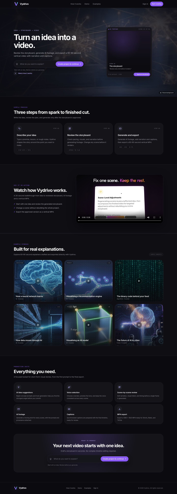
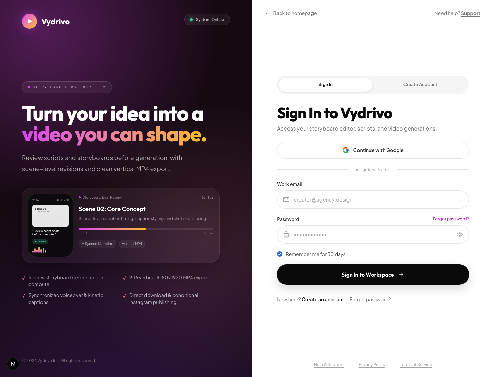
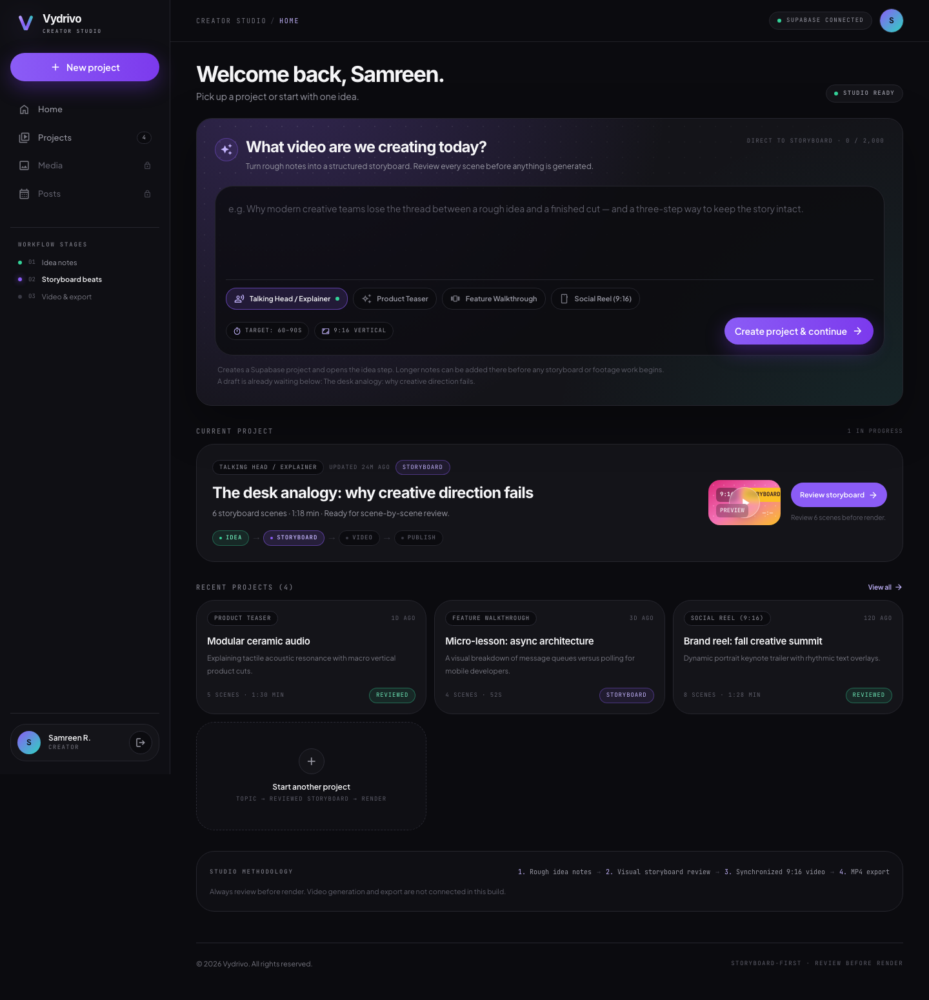
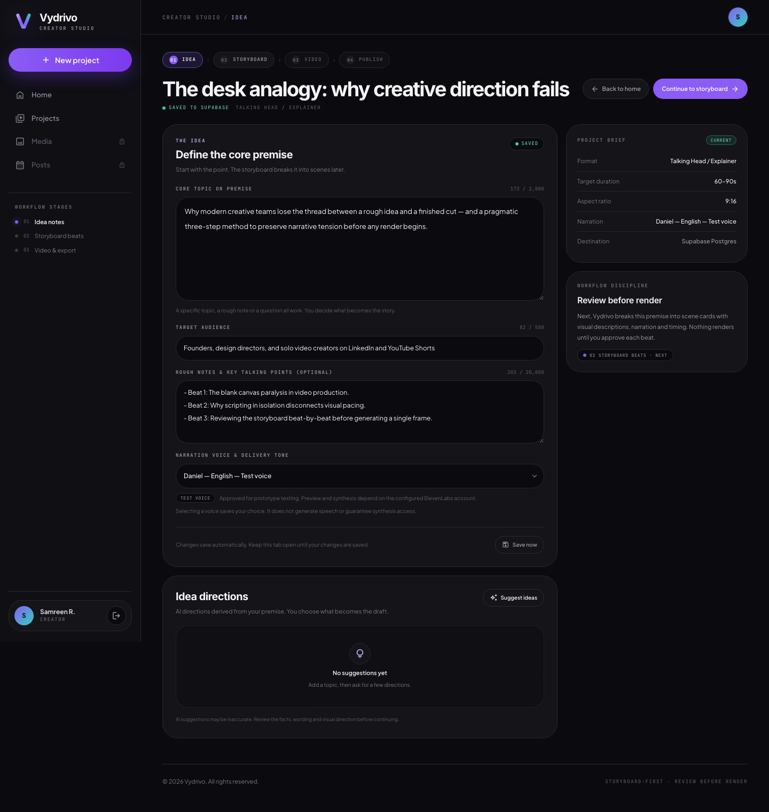
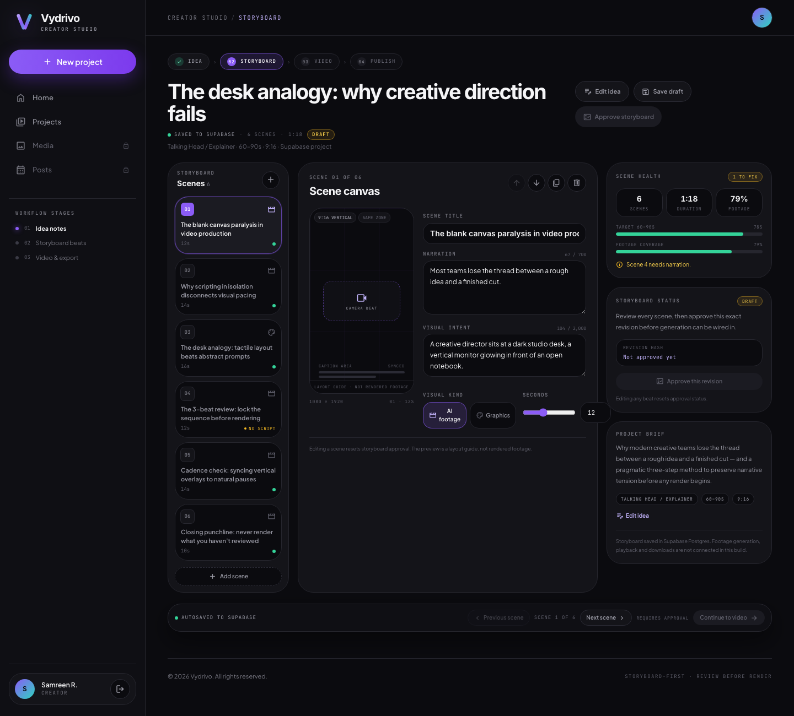
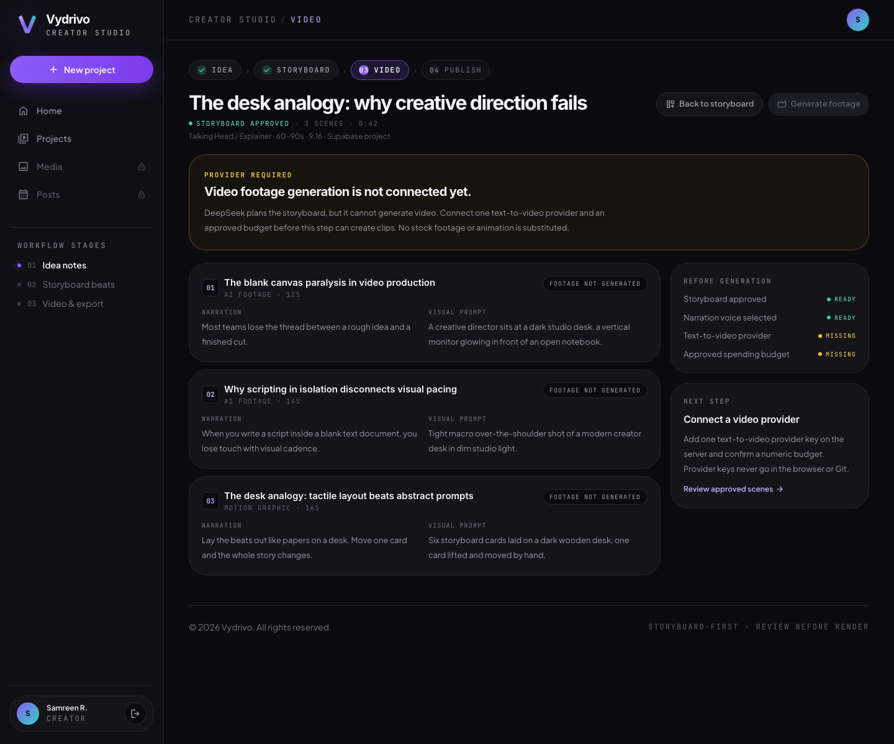
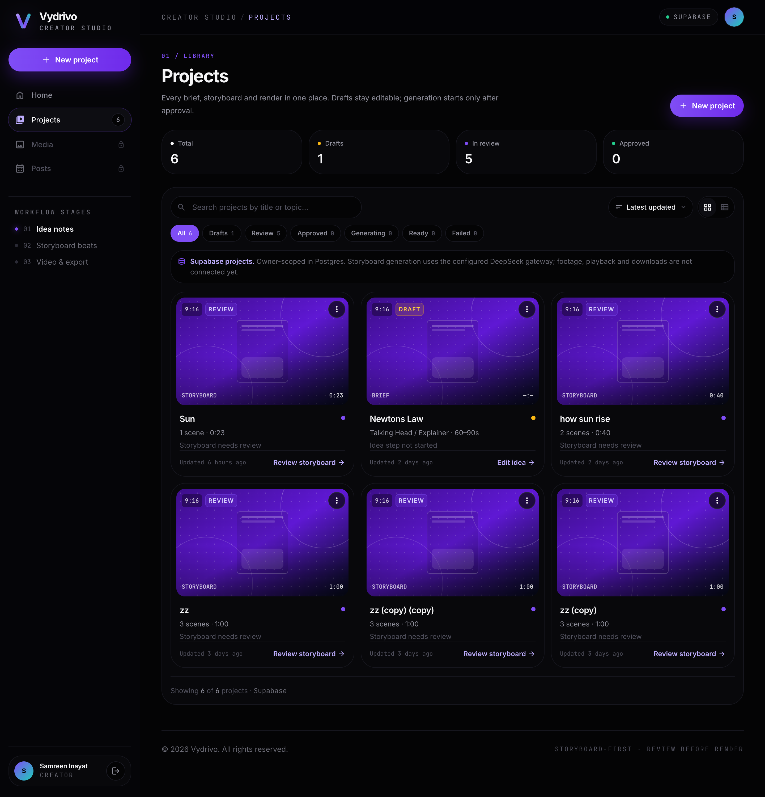

# Vydrivo

Vydrivo turns a short idea into a vertical explainer you can review before it
is exported. The studio follows one path: **Idea → Storyboard → Video → Publish**.

Live app: [https://dev.d35b51hio740im.amplifyapp.com](https://dev.d35b51hio740im.amplifyapp.com)

This repository is the public application structure. Generation, narration,
diagram rendering and private media storage stay in private services and are
not included here.

## Product

- Start from a topic, audience and notes.
- Review AI idea directions before committing to a script.
- Edit the storyboard scene by scene.
- Keep Hinglish text on screen and Hindi narration in the voice track.
- Export a vertical MP4 from an approved storyboard.
- Return to saved projects and completed videos.

Publishing to social platforms is a later step. The studio does not pretend
that step is finished.

## Screens

Landing



Sign in



Studio home



Idea



Storyboard



Video



Projects



## Stack

- Next.js 16 and React 19
- Supabase Auth and Postgres for signed-in projects
- AWS Amplify for the live app

## Local

```bash
npm ci
cp .env.example .env.local
npm run dev
```

Open `http://127.0.0.1:3000`.

Auth and generation need private configuration. Without it, the landing page
and studio shell still load, and the generation routes return an explicit
unavailable response.

## Layout

```text
app/            pages and API routes
components/     landing, auth and studio UI
lib/            session, projects and public helpers
lib/pipeline/   public interfaces for private services
supabase/       owner-scoped project migrations
public/portfolio  product screenshots
```

## Notes

- Do not commit `.env`, `.env.local`, provider keys or generated media.
- Sample videos are served from the media host in production. They are not
  stored in this repository.
- This copy is for review of the product structure. It is not a drop-in
  replacement for the private production services.
